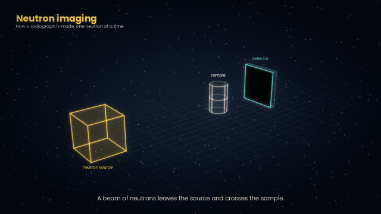

<p align="center">
  
</p>

<h1 align="center">SciView</h1>

<p align="center">Make clear, beautiful scientific explainer videos, with a visual editor or a few lines of Python.</p>

<p align="center">
  <a href="https://github.com/OriolSansPlanell/SciView/actions/workflows/ci.yml"></a>
  <a href="https://pypi.org/project/sciview/"></a>
  <a href="https://oriolsansplanell.github.io/SciView/"></a>
  <a href="https://github.com/OriolSansPlanell/SciView/blob/main/LICENSE"></a>
  
</p>

Most scientists explain their work with static slides, because animation tools are either made for
programmers (Manim), for 3D artists (Blender) or for marketing (After Effects). SciView sits in between: you
build a film from the things science talks about (beams, samples, detectors, curves, scatter plots,
equations, captions) and every one of them can be timed, keyframed and exported to a video you can drop
into a talk.

* **A visual editor** that runs in your browser: add objects, drag them in the preview, keyframe any value,
  arrange clips on a timeline, export.
* **From a sketch to a finished talk**: split the film into scenes with transitions and chapters, record
  your narration in the browser and lay captions onto it, apply your group's theme and logo, and export for
  slides, a 4K screen, a poster, social media, a web page or PowerPoint.
* **An assistant that builds with you**: ask a language model running on your computer to add, arrange
  and fix things; it checks its own work, flags the values it chose, and one Ctrl+Z takes it all back.
* **The same film in Python**: generate scenes from your own data with NumPy and render them from scripts or
  notebooks.
* **Made for science**: particle beams with scattering, detector images that build up count by count,
  tomography from sinogram to volume, molecules, ray optics, charts with error bars and fits whose axes,
  curves and markers animate, LaTeX equations, sub- and superscripts everywhere (`H_2O`, `^6Li`, `\mu`),
  subtitles exported for accessibility.
* **Easy to install**: pure Python on NumPy, OpenCV and Pillow. ffmpeg comes with the package. No LaTeX, no
  Cairo, no GPU needed.
* **Built to last**: a documented, versioned file format with a JSON Schema; films from every release keep
  opening; plugins add object types and templates; previews and the editor work in Jupyter notebooks.

<p align="center"></p>

## Install

```bash
pip install "sciview[math]"
```

The `math` extra installs matplotlib, which renders the LaTeX equations. Other extras: `science` for
isosurfaces, TIFF stacks, HDF5 volumes and SciPy fits; `pptx` for PowerPoint export; `tts` for reading
captions aloud; `all` for everything but `tts` (`pip install "sciview[math,science,pptx]"`). The newest
development version installs with `pip install "sciview[math] @ git+https://github.com/OriolSansPlanell/SciView"`.
SciView needs Python 3.10 or newer and works on Windows, macOS and Linux.

To try it without installing anything, open it in GitHub Codespaces: the editor starts with an example film.

<a href="https://codespaces.new/OriolSansPlanell/SciView"></a>

## Make your first film

```bash
sciview edit
```

Your browser opens the editor. Pick a template or an empty film, then:

1. **Add** objects from the list on the left. They appear at the current time.
2. **Place** them: drag objects in the preview, 2D and 3D alike (hold Shift to stay on one axis), or type
   values in the panel on the right. Drag empty space to orbit the 3D camera and scroll to zoom. Shift-click
   to select several objects, then align, distribute or group them (Ctrl+G) to move, scale, fade and time
   them together.
3. **Time** them: drag clips on the timeline to change when objects appear, and pick enter and exit effects
   (fade, slide, pop, draw on, type on).
4. **Animate** any value with the diamond next to it: set a value at one time, move the playhead, change it
   again. Gold labels show what is animated; draw your own easing curve for any keyframe.
5. **Tell the story** in scenes (the strip above the timeline): each has its own objects, camera and clock,
   and a transition into it. Press <kbd>R</kbd> to record narration while the film plays, then paste your
   script to turn it into captions that follow your voice.
6. **Export** with a preset (slides, conference 4K, poster still, square or vertical for social media,
   transparent overlay, web page) or choose MP4, WebM, ProRes, GIF, PNG frames or PowerPoint yourself.

Projects are saved as a readable `.sciview.json` file with an `assets` folder for your images and data.
The editor keeps unsaved changes next to the file every 30 seconds and offers them back if it stops before
you save. Press <kbd>?</kbd> in the editor for all shortcuts.

## Or write it in Python

```python
import numpy as np
import sciview as sv

film = sv.Project(title="Beer-Lambert", duration=8)

ax = film.add("axes", position=(260, 200), size=(1400, 620), x_range=(0, 5), y_range=(0, 1.05),
              x_label="thickness d (cm)", y_label="transmission T")
film.add("curve", axes=ax, expression="exp(-1.2*x)", color="teal", start=0.5)      # drawn on
dot = film.add("marker", axes=ax, x=0.0, follow="exp(-1.2*x)", label="T = {y:.2f}", start=2)
dot.key("x", 2.5, 0.0).key("x", 6.5, 4.0, ease="in_out")                           # slides along the curve

thickness = np.linspace(0.2, 4.8, 12)
film.add("scatter", axes=ax, x_values=thickness,
         y_values=np.exp(-1.2 * thickness) + np.random.normal(0, 0.02, 12), color="gold", size=5, start=4)
film.add("title", text="Beer–Lambert law", subtitle="Transmission falls exponentially with thickness")
film.add("caption", text="Each centimetre removes the same fraction of the beam.", start=3, end=7.5)

film.save("beer_lambert.sciview.json")   # open it later with: sciview edit beer_lambert.sciview.json
film.render("beer_lambert.mp4")          # or film.still(4.0, "frame.png", scale=2) for a poster figure
```

In a Jupyter notebook, `film.preview()` shows the film with a scrubber, and `sciview.jupyter.edit(film)` opens the
editor inside the notebook. The [example notebooks](https://github.com/OriolSansPlanell/SciView/tree/main/examples/notebooks)
go from data to film step by step: a tomography with segmentation, a Fourier analysis, a neutron diffraction
experiment with Rietveld refinement, and a tour of every feature. More in the [Python guide](https://github.com/OriolSansPlanell/SciView/blob/main/docs/python-api.md).

## Command line

```bash
sciview edit film.sciview.json                 # open (or create) a film in the editor
sciview new talk.sciview.json --template waves # start from a template
sciview render film.sciview.json -o film.mp4   # render; --scale 2 for 4K, --start/--end for a part
sciview render film.sciview.json --for vertical    # presets: slides, conference, poster, square, vertical ...
sciview render film.sciview.json -o talk.pptx  # one slide per scene; also .html for a web page
sciview render film.sciview.json --transparent -o overlay.mov  # ProRes 4444 with alpha
sciview still film.sciview.json -t 4.5 --scale 2   # a 3840 px PNG of one moment, for papers and posters
sciview subtitles film.sciview.json            # captions as an .srt file
sciview check film.sciview.json --frames       # problems, plus hard-to-read or overlapping text
sciview theme film.sciview.json --apply light  # themes: dark, light, contrast or your .sciview-theme.json
sciview render talk.sciview.json --part 2/4    # share a long render between computers, then: sciview join
sciview mcp film.sciview.json                  # let an outside AI assistant edit the film (MCP server)
sciview plugin new spectroscopy                # start a plugin with your own object types and templates
sciview schema --validate film.sciview.json    # check a file against the published JSON Schema
sciview info --report film.sciview.json        # a zip for a bug report (nothing is sent)
```

## What you can put in a film

<p align="center"></p>

| | Objects |
| --- | --- |
| **3D scene** | box, cylinder, sphere, screen/detector with an image, particle beam with scattering, 3D arrow, floor grid, point cloud from a table, STL/OBJ model, 3D label, volume (slices, maximum-intensity projection, isosurface) from `.npy`, TIFF stacks or HDF5, molecule from PDB/XYZ (ball-and-stick, space-filling, ribbon), 3D scale bar |
| **Text** | title, caption (plain, boxed, band, outline or shadow; also exported as subtitles), text with live counters and SI prefixes, LaTeX equation, legend |
| **Charts** | axes (linear or log, animatable ranges), curve from an expression or data, scatter, bars, histogram, marker that follows a curve, threshold line, heatmap with colour bar, error bars, uncertainty band, fitted curve, spectrum with labelled peaks, 2D histogram, vector field, streamlines, matplotlib figure redrawn per frame (from Python) |
| **Imaging** | sinogram recorded angle by angle, filtered back-projection that builds up the slice, scale bar from the pixel size, pixels that fly into a scatter plot or histogram bins |
| **Optics** | thin lenses, flat and curved mirrors, beam splitters, rays traced through them, wavefronts |
| **Shapes & media** | panel/card with numbered badge, rectangle, ellipse, arrow, image (PNG, 16-bit TIFF, NumPy arrays, with colormaps), group |
| **Sound** | voice clips (recorded in the editor, uploaded, or read aloud by text to speech) with waveforms on the timeline, a soundtrack under the whole film |

Plugins add more: `pip install` one and its objects appear in the library ([writing a plugin](https://github.com/OriolSansPlanell/SciView/blob/main/docs/plugins.md)). Every template is in the [gallery](https://oriolsansplanell.github.io/SciView/gallery/) as a film with its project.

Curve expressions can use time: `sin(x - 2*t)` is a travelling wave. Any number can follow a column of a table
over time (a **data track**), and any file field can play a series of files, one per step: a stack of
radiographs, the outputs of a simulation. The full list of properties is in the
[object reference](https://github.com/OriolSansPlanell/SciView/blob/main/docs/objects.md).

## Let an AI assistant help

The editor's **Assistant** panel talks to a language model on your own computer (Ollama, LM Studio, a
llama.cpp server, vLLM): "add a scene that zooms into the sample", "put the captions in boxes", "line up the
three panels". It works through a small set of checked tools, never runs code and keeps away from locked
objects. After each step SciView checks the frames for overlapping text and objects outside the picture and
tells the model, which fixes its own mistakes; the values it chose itself are listed for you to check; and
the whole request is one undo step. A benchmark of 42 tasks (`python -m sciview.agent.bench`) compares models.

`sciview mcp film.sciview.json` offers the same tools to outside assistants (Claude Desktop, LM Studio's chat,
any [MCP](https://modelcontextprotocol.io) client), limited to a time window, a scene or a few objects if you
like. See [AI assistants](https://github.com/OriolSansPlanell/SciView/blob/main/docs/agent.md).

## How it works

Every frame is a pure function of time: `frame(t)` builds the picture from the project and nothing is carried
over from the previous frame. That makes any moment reproducible on its own, lets the preview jump anywhere
instantly and lets exports render frames in parallel on all CPU cores. Objects that do not change between
frames are drawn once into cached layers, which never changes a pixel but saves work.

Objects draw anti-aliased geometry with OpenCV into a float canvas and send light into a separate glow
buffer, which is blurred at several scales and added back (the neon look). Particles are accumulated and
compressed with 1 − exp(−x), so dense beams glow instead of clipping to white. Text goes through Pillow with a
small markup for sub/superscripts and symbols, and falls back to a second font for missing glyphs. Frames are
piped straight into ffmpeg. The editor is a static web page served by a small local Python server; it sends
the project as JSON and shows the frames Python renders, so the preview and the export are pixel-identical.

The design started as the renderer behind two neutron imaging films for a conference talk, generalised so
that anyone can make films like them without writing a renderer.

## Documentation

The documentation is online at [oriolsansplanell.github.io/SciView](https://oriolsansplanell.github.io/SciView/) and in the repository:

* [Getting started](https://github.com/OriolSansPlanell/SciView/blob/main/docs/getting-started.md)
* [The editor](https://github.com/OriolSansPlanell/SciView/blob/main/docs/editor.md)
* [Python guide](https://github.com/OriolSansPlanell/SciView/blob/main/docs/python-api.md)
* [Object reference](https://github.com/OriolSansPlanell/SciView/blob/main/docs/objects.md)
* [Rendering and sharing](https://github.com/OriolSansPlanell/SciView/blob/main/docs/rendering.md)
* [AI assistants](https://github.com/OriolSansPlanell/SciView/blob/main/docs/agent.md)
* [Notebooks](https://github.com/OriolSansPlanell/SciView/blob/main/docs/jupyter.md)
* [Plugins](https://github.com/OriolSansPlanell/SciView/blob/main/docs/plugins.md)
* [Project file format](https://github.com/OriolSansPlanell/SciView/blob/main/docs/file-format.md)
* [Stability](https://github.com/OriolSansPlanell/SciView/blob/main/docs/stability.md): what stays the same within 1.x
* [Troubleshooting](https://github.com/OriolSansPlanell/SciView/blob/main/docs/troubleshooting.md)

## Citing SciView

If SciView helps you communicate your research, please cite it. GitHub's "Cite this repository" button gives
the reference from [CITATION.cff](https://github.com/OriolSansPlanell/SciView/blob/main/CITATION.cff).

## Contributing

Bug reports, templates and new object types are very welcome. See [CONTRIBUTING.md](https://github.com/OriolSansPlanell/SciView/blob/main/CONTRIBUTING.md); a new
object type is one class with a list of properties and a `draw` method, and it appears in the editor
automatically. How decisions are made is in [GOVERNANCE.md](https://github.com/OriolSansPlanell/SciView/blob/main/GOVERNANCE.md).

## Licence

SciView is released under the [MIT licence](https://github.com/OriolSansPlanell/SciView/blob/main/LICENSE). The bundled Poppins and Inter fonts are under the SIL
Open Font License (see `src/sciview/fonts`).
