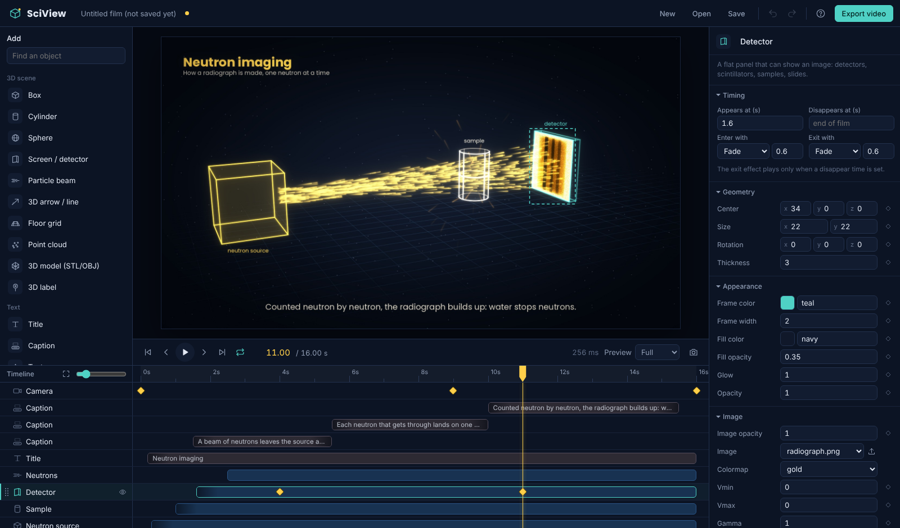
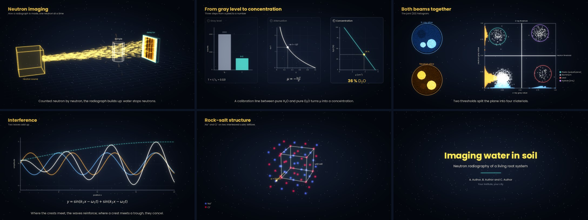

<p align="center">
  
</p>

<h1 align="center">SciView</h1>

<p align="center">Make clear, beautiful scientific explainer videos, with a visual editor or a few lines of Python.</p>

<p align="center">
  <a href="https://github.com/OriolSansPlanell/SciView/actions/workflows/ci.yml"></a>
  <a href="LICENSE"></a>
  
</p>

Most scientists explain their work with static slides, because animation tools are either made for
programmers (Manim), for 3D artists (Blender) or for marketing (After Effects). SciView sits in between: you
build a film from the things science talks about (beams, samples, detectors, curves, scatter plots,
equations, captions) and every one of them can be timed, keyframed and exported to a video you can drop
into a talk.

* **A visual editor** that runs in your browser: add objects, drag them in the preview, keyframe any value,
  arrange clips on a timeline, export.
* **The same film in Python**: generate scenes from your own data with NumPy and render them from scripts or
  notebooks.
* **Made for science**: particle beams with scattering, detector images that build up count by count,
  charts whose axes, curves and markers animate, LaTeX equations, sub- and superscripts everywhere
  (`H_2O`, `^6Li`, `\mu`), subtitles exported for accessibility.
* **Easy to install**: pure Python on NumPy, OpenCV and Pillow. ffmpeg comes with the package. No LaTeX, no
  Cairo, no GPU needed.

<p align="center"></p>

## Install

```bash
pip install "sciview[math] @ git+https://github.com/OriolSansPlanell/SciView"
```

The `math` extra installs matplotlib, which renders the LaTeX equations. SciView needs Python 3.9 or newer
and works on Windows, macOS and Linux.

## Make your first film

```bash
sciview edit
```

Your browser opens the editor. Pick a template or an empty film, then:

1. **Add** objects from the list on the left. They appear at the current time.
2. **Place** them: drag text and shapes in the preview, or type values in the panel on the right. Drag
   empty space in the preview to orbit the 3D camera and scroll to zoom.
3. **Time** them: drag clips on the timeline to change when objects appear, and pick enter and exit effects
   (fade, slide, pop, draw on, type on).
4. **Animate** any value with the diamond next to it: set a value at one time, move the playhead, change it
   again. Gold labels show what is animated.
5. **Export** an MP4 for slides, a WebM for the web, ProRes for video editors, a GIF or PNG frames.

Projects are saved as a readable `.sciview.json` file with an `assets` folder for your images and data.
Press <kbd>?</kbd> in the editor for all shortcuts.

## Or write it in Python

```python
import numpy as np
import sciview as sv

film = sv.Project(title="Beer-Lambert", duration=8)

ax = film.add("axes", position=(260, 200), size=(1400, 620), x_range=(0, 5), y_range=(0, 1.05),
              x_label="thickness d (cm)", y_label="transmission T")
film.add("curve", axes=ax, expression="exp(-1.2*x)", color="teal", start=0.5)      # drawn on
dot = film.add("marker", axes=ax, x=0.0, follow="exp(-1.2*x)", label="T = {y:.2f}", start=2)
dot.key("x", 2.5, 0.0).key("x", 6.5, 4.0, ease="in_out")                           # slides along the curve

thickness = np.linspace(0.2, 4.8, 12)
film.add("scatter", axes=ax, x_values=thickness,
         y_values=np.exp(-1.2 * thickness) + np.random.normal(0, 0.02, 12), color="gold", size=5, start=4)
film.add("title", text="Beer–Lambert law", subtitle="Transmission falls exponentially with thickness")
film.add("caption", text="Each centimetre removes the same fraction of the beam.", start=3, end=7.5)

film.save("beer_lambert.sciview.json")   # open it later with: sciview edit beer_lambert.sciview.json
film.render("beer_lambert.mp4")          # or film.still(4.0, "frame.png", scale=2) for a poster figure
```

More in [examples/](examples/) and the [Python guide](docs/python-api.md).

## Command line

```bash
sciview edit film.sciview.json                 # open (or create) a film in the editor
sciview new talk.sciview.json --template waves # start from a template
sciview render film.sciview.json -o film.mp4   # render; --scale 2 for 4K, --start/--end for a part
sciview still film.sciview.json -t 4.5 --scale 2   # a 3840 px PNG of one moment, for papers and posters
sciview subtitles film.sciview.json            # captions as an .srt file
sciview check film.sciview.json                # missing files, broken references, bad expressions
```

## What you can put in a film

<p align="center"></p>

| | Objects |
| --- | --- |
| **3D scene** | box, cylinder, sphere, screen/detector with an image, particle beam with scattering, 3D arrow, floor grid, point cloud from a table, STL/OBJ model, 3D label |
| **Text** | title, caption (also exported as subtitles), text with live counters, LaTeX equation, legend |
| **Charts** | axes (linear or log, animatable ranges), curve from an expression or data, scatter, bars, histogram, marker that follows a curve, threshold line |
| **Shapes & media** | panel/card with numbered badge, rectangle, ellipse, arrow, image (PNG, 16-bit TIFF, NumPy arrays, with colormaps) |

Curve expressions can use time: `sin(x - 2*t)` is a travelling wave. The full list of properties is in the
[object reference](docs/objects.md).

## How it works

Every frame is a pure function of time: `frame(t)` builds the picture from the project and nothing is carried
over from the previous frame. That makes any moment reproducible on its own, lets the preview jump anywhere
instantly and lets exports render frames in parallel on all CPU cores.

Objects draw anti-aliased geometry with OpenCV into a float canvas and send light into a separate glow
buffer, which is blurred at several scales and added back (the neon look). Particles are accumulated and
compressed with 1 − exp(−x), so dense beams glow instead of clipping to white. Text goes through Pillow with a
small markup for sub/superscripts and symbols, and falls back to a second font for missing glyphs. Frames are
piped straight into ffmpeg. The editor is a static web page served by a small local Python server; it sends
the project as JSON and shows the frames Python renders, so the preview and the export are pixel-identical.

The design started as the renderer behind two neutron imaging films for a conference talk, generalised so
that anyone can make films like them without writing a renderer.

## Documentation

* [Getting started](docs/getting-started.md)
* [The editor](docs/editor.md)
* [Python guide](docs/python-api.md)
* [Object reference](docs/objects.md)
* [Rendering and sharing](docs/rendering.md)
* [Project file format](docs/file-format.md)
* [Troubleshooting](docs/troubleshooting.md)

## Citing SciView

If SciView helps you communicate your research, please cite it. GitHub's "Cite this repository" button gives
the reference from [CITATION.cff](CITATION.cff).

## Contributing

Bug reports, templates and new object types are very welcome. See [CONTRIBUTING.md](CONTRIBUTING.md); a new
object type is one class with a list of properties and a `draw` method, and it appears in the editor
automatically.

## Licence

SciView is released under the [MIT licence](LICENSE). The bundled Poppins and Inter fonts are under the SIL
Open Font License (see `src/sciview/fonts`).
