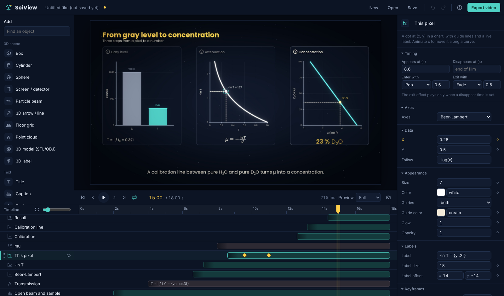

# The editor

Start it with `sciview edit` (an untitled film in the current folder) or `sciview edit film.sciview.json`.
The editor is a web page served by Python on your own computer; nothing is uploaded anywhere.



## Layout

| Area | What it is for |
| --- | --- |
| **Add** (left) | The object library. Click an object to add it at the playhead. Type in the search box to filter. |
| **Preview** (centre) | The frame at the playhead, rendered by the same code as the export. |
| **Transport** (under the preview) | Play, step frames, loop, type a time, choose the preview quality, save the frame as PNG. |
| **Properties** (right) | The selected object's timing and properties. With nothing selected: film settings and palette. |
| **Timeline** (bottom) | One row per object, the top row drawn on top. Clips show when objects are visible, diamonds are keyframes. |

## Selecting and moving

* Click an object in the preview or its row in the timeline to select it. <kbd>Esc</kbd> selects nothing.
* <kbd>Shift</kbd>-click adds an object to the selection or takes it out, in the preview and in the timeline.
  <kbd>Ctrl</kbd>-drag (<kbd>Cmd</kbd> on a Mac) on empty space in the preview selects everything inside a
  box; <kbd>Ctrl</kbd>+<kbd>A</kbd> selects every object.
* Drag objects in the preview to move them, 2D and 3D alike. A 3D object moves in the plane facing the camera,
  so it stays under the mouse; hold <kbd>Shift</kbd> to move along one axis only (the screen axis for 2D
  objects, the scene axis closest to the drag for 3D ones). Dragging one of several selected objects moves
  them all.
* Drag empty space to orbit the camera, or hold <kbd>Alt</kbd> to orbit even over an object;
  <kbd>Shift</kbd>+drag on empty space shifts the 3D scene on screen; scroll to zoom. If the camera is
  animated, these changes add a camera keyframe at the playhead.
* Drag a value's label left or right to change a number (<kbd>Shift</kbd> for big steps, <kbd>Alt</kbd> for
  fine ones). Arrow keys in a number field do the same.

### Several objects

With more than one object selected, the properties panel offers:

* **Arrange**: align left edges, centres or right edges, tops, middles or bottoms, and spread three or more
  objects so the gaps between them are equal. These use where the objects are in the picture at the
  playhead.
* **Stagger**: start each object a set delay after the one before, keyframes included. Objects that start
  earlier go first, then the order they were added.
* Values shared by all of them, when they are of one kind: a change applies to every selected object.
* **Group**, **Duplicate** and **Delete**.

### Groups

A group holds objects that belong together: a panel and the chart on it, the parts of an instrument.
Select them and press <kbd>Ctrl</kbd>+<kbd>G</kbd>; <kbd>Ctrl</kbd>+<kbd>Shift</kbd>+<kbd>G</kbd> takes
them out again. The group's members keep all their own values, and the group adds to them:

* **Offset** and **scale** (about the **pivot**) for 2D members, and **position**, **rotation** and
  **scale** (about the 3D pivot) for 3D members. These can be keyframed like anything else.
* **Opacity**, **enter and exit effects** and **when it is visible**: a group that fades out fades all its
  members; members show only while their group does.

Clicking a grouped object in the preview selects its group, so a drag moves the whole group. Double-click
to select the object inside it; <kbd>Esc</kbd> goes back up to the group. In the timeline, members sit
under their group's row and the arrow folds them away; moving the group's clip moves its members' clips
too. To put an object in a group, pick the group under **In group** in its **Timing** section, or drag its
row just below the group's row. Groups can contain groups.

### Copy and paste

<kbd>Ctrl</kbd>+<kbd>C</kbd>, <kbd>Ctrl</kbd>+<kbd>X</kbd> and <kbd>Ctrl</kbd>+<kbd>V</kbd> copy, cut and
paste the selection, between films too. A group comes with its members; a curve copied with its chart
keeps drawing in the copied chart. Pasted objects keep their timing relative to the playhead: an object
that started a second after the playhead when you copied it starts a second after the playhead where you
paste it. With a keyframe picked in the timeline, copy takes that keyframe instead, and paste adds it to the
selected objects at the playhead.

## Timing

Each object has a clip on the timeline:

* Drag the clip to move it in time; its keyframes move with it.
* Drag its left or right edge to change when it appears or disappears.
* The shaded ends of a clip are the enter and exit effects. Choose them in **Timing** in the properties panel:
  fade, slide (four directions), pop, **draw on** (lines, shapes, charts, 3D wireframes) and **type on**
  (text). An exit effect plays only when the object has a disappear time.
* Drag the grip at the left of a row to change the drawing order.

Clips snap to frames, to the playhead and to the start and end of the film.

## Keyframes

Any number, colour or position can change over time:

1. Move the playhead and click the diamond next to a value. The label turns gold: the value is animated.
2. Move the playhead elsewhere and change the value. A new keyframe is added there automatically.
3. Gold diamonds appear on the object's clip. Drag them to retime, click one to jump to it, press
   <kbd>Del</kbd> to delete the selected one.
4. The **Keyframes** group lists them all; choose how each one eases in (smooth, linear, in, out, in-out,
   overshoot, hold ...). Choose **custom** to draw the curve yourself: drag its two handles, type the four
   numbers or start from a preset. Handles above the box overshoot. The numbers are those of CSS
   `cubic-bezier()`, so curves can be copied to and from web animation tools.

<kbd>K</kbd> keyframes every animatable value of the selection at once, which is handy before a camera move.

The **camera** is the first timeline row. Keyframe its azimuth, elevation and distance for orbits and zooms,
its target to pan, and its offset to slide the 3D scene sideways when 2D panels share the frame.

## Text markup

Every text field understands:

| Type | You get |
| --- | --- |
| `H_2O`, `^6LiF` | H₂O, ⁶LiF (one character lowered / raised) |
| `x_{max}`, `e^{-x/2}` | groups |
| `\alpha \mu \Delta \AA \deg \to \pm \times \approx` | α μ Δ Å ° → ± × ≈ |
| `**bold**` | bold |
| `{value:.1f}` | in a Text object, its animated *Value* (counters) |

Equations use full LaTeX math syntax through the **Equation** object, e.g. `\mu = -\frac{\ln T}{d}`.

## Data and images

Upload files with the arrow button next to any file field, or drop them on the preview: images become Image
objects, 3D models become 3D models and audio becomes the film's soundtrack. Tables (CSV, TSV, whitespace
text, `.npy`, `.npz`) are used by scatter plots, curves, histograms and point clouds; the column fields suggest
the names found in the file. Volumes (`.npy`, TIFF stacks, HDF5) go in a **Volume**, and PDB or XYZ files in a
**Molecule**.

### Series of files

Upload several files at once in a file field and they become a sequence, shown one file per step: a time
series of images, the outputs of a simulation. The field then holds a pattern such as
`assets/run/step_*.csv` (choose **File pattern…** to type one). Files are taken in natural order, so
`step_2` comes before `step_10`. Set **Steps per second** to play the files from the moment the object appears,
or keyframe **Step** to choose which file shows when (both can be combined). Tables with the same number of rows are blended between
files, so points move smoothly.

## Data tracks

A data track makes a property follow a column of a table over time instead of keyframes: a temperature log
that drives a counter, a measured trajectory, the intensity of a source. Under **Data tracks** in the
properties panel, choose the property and press **Add**, then pick the table, the **time column** (in seconds
of the film; shift it with **Starts at** and stretch it with **Time scale**) and the **value column**. For an
x, y or x, y, z property, give two or three columns separated by commas. **Scale** and **Offset** convert the
values. Properties driven by data are marked "⟵ data" in blue, and a track takes the place of the
property's keyframes. The camera's tracks can be set from Python (`film.camera.track(...)`).

## Problems

A warning sign on a timeline row means something stops that object from drawing as intended: a file that
is missing, an expression that cannot be read, a chart that no longer exists. Select the object: the
properties panel says what is wrong and marks the field to fix in gold. The count under the preview lists
every problem in the film; click one to jump to its object.

## Working with an AI assistant

An AI assistant connected with `sciview mcp --editor http://localhost:8765` (see [AI assistants](agent.md))
changes the film in the open editor. Each of its changes appears within about a second, with a short note of
what it did. Press Ctrl+Z to take back a change you do not want: **Undo** treats it like your own edits
(changes that arrive within the same second are undone together). If you edit something at the same moment,
your edit is kept and the assistant's change is made again on top of it. Locked objects are never touched by
the assistant.

## Autosave

Every 30 seconds, and when the editor stops, unsaved changes are written next to the film as a hidden file
(`.film.sciview.json.autosave`). If the editor stops before you save, the next time you open the film it
offers to **restore** those changes or **discard** them. Restored changes are not saved until you press
Save, and saving removes the autosave.

## Film settings

Select nothing to edit the size, frame rate, duration, background, starfield, vignette, glow strength, font
and soundtrack. **Light for papers** switches to a white background and darker palette. The **palette** names
colours used across the film: change `teal` once and everything teal follows.

## Shortcuts

| Keys | Action |
| --- | --- |
| <kbd>Space</kbd> | play / pause |
| <kbd>←</kbd> <kbd>→</kbd> | previous / next frame (<kbd>Shift</kbd>: one second) |
| <kbd>Home</kbd> <kbd>End</kbd> | start / end |
| <kbd>K</kbd> | keyframe all values of the selection |
| <kbd>Del</kbd> | delete the selected keyframe, or the selected objects (a group with its members) |
| <kbd>Ctrl</kbd>+<kbd>D</kbd> | duplicate |
| <kbd>Ctrl</kbd>+<kbd>C</kbd> / <kbd>X</kbd> / <kbd>V</kbd> | copy, cut, paste objects or the picked keyframe |
| <kbd>Ctrl</kbd>+<kbd>G</kbd> / <kbd>Ctrl</kbd>+<kbd>Shift</kbd>+<kbd>G</kbd> | group / ungroup |
| <kbd>Ctrl</kbd>+<kbd>A</kbd> | select every object |
| <kbd>Shift</kbd>+click | add to or take out of the selection |
| double-click | select an object inside its group |
| <kbd>Esc</kbd> | leave the group, then select nothing |
| <kbd>Ctrl</kbd>+<kbd>Z</kbd> / <kbd>Ctrl</kbd>+<kbd>Shift</kbd>+<kbd>Z</kbd> | undo / redo |
| <kbd>Ctrl</kbd>+<kbd>S</kbd> | save (<kbd>Shift</kbd>: save as) |
| <kbd>Ctrl</kbd>+scroll on the timeline | zoom the timeline |
| <kbd>?</kbd> | help |

## Using the editor on a remote machine

The editor listens only on your own computer. To use it on a beamline or cluster machine, start it there and
forward the port over SSH:

```bash
ssh -L 8765:localhost:8765 user@analysis-machine
sciview edit film.sciview.json --no-browser
```

Then open `http://localhost:8765` in your local browser. Export downloads come back through the same tunnel.
