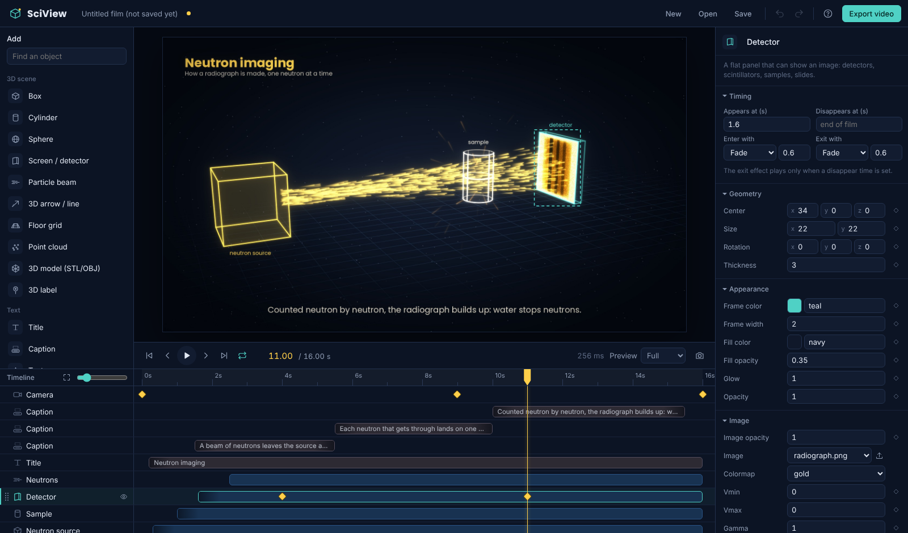

# SciView

SciView makes scientific explainer videos: beams, samples, detectors, charts, equations and captions, timed
and keyframed in a visual editor or from Python, exported to video for talks, lectures and the web.

* [Getting started](getting-started.md): install, first film in the editor and in Python.
* [The editor](editor.md): panels, timeline, keyframes, markup, shortcuts, remote use.
* [Python guide](python-api.md): data-driven films and new object types.
* [Object reference](objects.md): every object and property.
* [Rendering and sharing](rendering.md): formats, resolution, sound, subtitles, stills, slides.
* [Project file format](file-format.md): the JSON that the editor and Python share.
* [Troubleshooting](troubleshooting.md)
